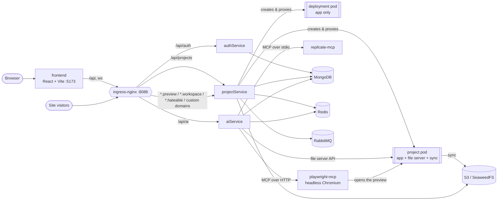
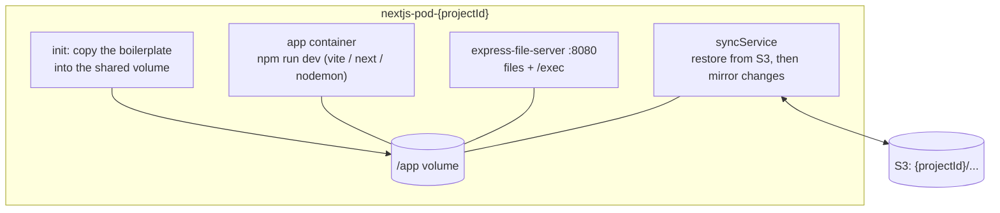
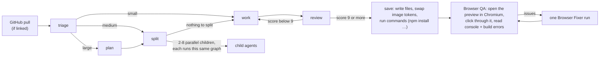

# hateable

**Describe an app. Watch AI agents build it. Ship it with one click.**

hateable is a self-hosted AI app builder in the spirit of Lovable / Bolt / v0. You pick a stack
(React, Next.js, Node, MERN), chat with a team of AI agents that write the code into a live,
sandboxed workspace, watch it hot-reload in the preview, and deploy it to
`your-app.hateable.bhavyadhanwani.dev` (or your own domain) with one click.

Everything runs on Kubernetes: every project gets its own pod, every deployment its own pod that
sleeps when nobody visits and wakes up on the next visitor.

---

## Contents

1. [What you can do](#what-you-can-do)
2. [Architecture](#architecture)
3. [Repository layout](#repository-layout)
4. [How a project workspace works](#how-a-project-workspace-works)
5. [The AI agents](#the-ai-agents)
6. [Deployments](#deployments)
7. [Terminal, logs and GitHub](#terminal-logs-and-github)
8. [Running it locally](#running-it-locally)
9. [Configuration](#configuration)
10. [Testing and code quality](#testing-and-code-quality)
11. [Troubleshooting](#troubleshooting)
12. [Going to production](#going-to-production)
13. [Security model](#security-model)

---

## What you can do

|                          |                                                                                                                                                                                      |
| ------------------------ | ------------------------------------------------------------------------------------------------------------------------------------------------------------------------------------ |
| **Build with AI**        | Describe what you want; a hierarchy of agents plans, splits the work, writes and reviews the code, installs dependencies, and checks the result in a real browser.                   |
| **Edit by hand**         | Monaco code editor with a file explorer, live preview, a real terminal in the project, and live dev-server logs.                                                                     |
| **Images**               | Agents drop in Unsplash photos (credited) and AI-generated images (FLUX through Replicate's MCP server).                                                                             |
| **Deploy in one click**  | `https://<project>.hateable.bhavyadhanwani.dev`, frozen as a snapshot, asleep after 15 idle minutes, woken by the next visitor behind a minimal loader.                              |
| **Deployment dashboard** | Overview · Analytics (visitors, views, live now, referrers, devices…) · Logs (cleaned up) · Custom domains · Environment variables · an AI that explains what happened to your site. |
| **GitHub**               | Connect once, push any project to a repo (created if missing) in one click; edits made on GitHub are pulled in before every AI run.                                                  |

---

## Architecture



| Service                 | Folder                                        | What it does                                                                                                                                            |
| ----------------------- | --------------------------------------------- | ------------------------------------------------------------------------------------------------------------------------------------------------------- |
| **frontend**            | [`frontend/`](frontend)                       | React 19 + Vite + Tailwind v4. Landing, auth, projects, the workspace (chat, editor, preview, terminal, logs) and the deployment dashboard.             |
| **authService**         | [`authService/`](authService)                 | Sign-up / login / Google login, OTP e-mail, access + refresh tokens (refresh in an httpOnly cookie).                                                    |
| **projectService**      | [`projectService/`](projectService)           | Projects and their pods, the preview/workspace/deployment proxy, idle reaper, deployments, analytics, logs, terminal WebSocket, custom domains, GitHub. |
| **aiService**           | [`aiService/`](aiService)                     | Chat + the multi-agent system (LangGraph + Mistral), prompts and skills, browser QA (Playwright MCP), images, the site AI.                              |
| **express-file-server** | [`express-file-server/`](express-file-server) | Runs **inside** every project pod: read/write/delete files, the file tree, and `/exec` for running commands.                                            |
| **syncService**         | [`syncService/`](syncService)                 | Runs **inside** every project pod: restores the project from S3 on start, then mirrors every change back to S3.                                         |
| **boilerplates**        | [`boilerplates/`](boilerplates)               | The starter apps a project begins from (React / Next.js / Node / MERN, each in JS and TS), one image each.                                              |
| **k8s**                 | [`k8s/`](k8s)                                 | Every manifest: services, Mongo, Redis, S3, Playwright MCP, ingress, RBAC, secrets.                                                                     |

**Request routing** happens in one place, [`projectService/src/shared/middlewares/proxy.middleware.ts`](projectService/src/shared/middlewares/proxy.middleware.ts), by the `Host` header:

| Host                              | Goes to                                         |
| --------------------------------- | ----------------------------------------------- |
| `<projectId>.preview.localhost`   | the project pod's dev server (the live preview) |
| `<projectId>.workspace.localhost` | the project pod's file server (editor, AI)      |
| `<slug>.hateable.localhost`       | the deployment pod, waking it if asleep         |
| a verified custom domain          | the deployment it is connected to               |
| anything else                     | the projectService API                          |

---

## Repository layout

```
hateable/
├─ frontend/                 React app (pages/, components/, api/, utils/)
├─ authService/              ┐
├─ projectService/           │ Express + TypeScript services, same structure:
├─ aiService/                ┘   src/modules/<feature>/{controller,router,validator}.ts
│                                src/shared/{config,constants,dao,errors,middlewares,models,
│                                            responses,routers,services,utils}
├─ aiService/prompts/        every agent's system prompt, as editable Markdown
│  └─ skills/                frontend skills agents load on demand
├─ express-file-server/      file API inside each project pod
├─ syncService/              S3 sync inside each project pod
├─ boilerplates/             8 starter apps (react/next/node/mern × js/ts)
├─ k8s/                      Kubernetes manifests
├─ skaffold.yaml             builds every image and runs the stack in dev
├─ pnpm-workspace.yaml       one pnpm workspace for everything
└─ projectService/DEPLOYMENTS.md   the deployment system in depth
```

---

## How a project workspace works

Creating a project (`POST /api/projects`) makes a Mongo record and one **pod** with:



- **The volume is shared**, so a file the AI or editor writes through the file server appears in
  the dev server instantly (hot reload) and is uploaded to S3 by the sync container.
- **S3 is the source of truth.** Pods are disposable: an idle preview is reaped after 10 minutes
  (a Redis key expiring) and rebuilt from S3 the next time you open the project.
- **The file server waits for the sync.** Until the sync container has restored the workspace
  and is watching it, the file server answers `503`. Otherwise an early write could be
  overwritten by the restore, or never reach S3. Callers retry.
- MERN projects run a client and a server container side by side (`/app/client`, `/app/server`).

---

## The AI agents

Chat goes to `POST /api/ai/chat` (server-sent events). With `AGENT_SYSTEM_V2=true` it runs the
**multi-agent system** in [`aiService/src/shared/agents/graph.ts`](aiService/src/shared/agents/graph.ts):



- **Every agent is the same graph.** A "Boss" receives your request. It may hire a frontend lead
  and a backend lead, who may hire one agent per page, and so on, all in parallel. The shared
  contracts (paths, routes, props) are handed down so siblings agree without talking.
- **Work ↔ review loop.** A reviewer scores each agent's code out of 10 against the task, the
  contracts and the agent's **skills**, and sends it back until it reaches 9.
- **Skills** ([`aiService/prompts/skills/`](aiService/prompts/skills)) are focused know-how an agent loads only when its
  task needs it. Triage picks them from their one-line descriptions:
  `frontend-design`, `responsive-layout`, `accessibility`, `react-patterns`, `styling-css`,
  `ui-states-and-motion`, `nextjs-app-router`. Add a skill by dropping in a Markdown file whose
  first line is `description: …`.
- **Prompts are files.** Every system prompt is a Markdown file in [`aiService/prompts/`](aiService/prompts),
  read on each call, so an edit applies to the next message without a restart.
- **Commands.** Workers can list shell commands (e.g. `npm install zod`). They run in the pod
  through the file server's `/exec`, and every command and its result shows in the chat.
- **Images.** Code uses tokens like `{{img:hero}}`. On save they become a credited Unsplash photo
  URL, or a FLUX-generated image saved into `public/`. If neither is available they become a
  neutral placeholder, so a build never breaks on a missing image.
- **Browser QA** uses [Playwright MCP](https://github.com/microsoft/playwright-mcp) as an in-cluster service. A NetworkPolicy
  lets that browser reach only project previews, and its `navigate` tool is pinned to the preview it checks.
- **Model calls** go through a round-robin pool of Mistral keys ([`keyPool.ts`](aiService/src/shared/agents/keyPool.ts)).
  Rate-limited keys cool down and rejected keys are dropped.

---

## Deployments

One click on **Deploy** and:

1. The project's S3 files are copied server-side to `deployments/<slug>/`, a frozen snapshot.
   Later edits don't touch the live site until you redeploy.
2. A deployment pod starts: an init container restores the snapshot, then the app runs.
3. The site is live at `http://<slug>.hateable.localhost:8088` locally
   (`https://<slug>.hateable.bhavyadhanwani.dev` in production).
4. A Redis key with a **15-minute sliding TTL** keeps it awake; every visit resets it. When it
   expires, a keyspace event deletes the pod. The last logs are snapshotted first.
5. The next visitor gets a minimal "starting up" page that polls and hands off to the real site
   as soon as it answers (a ~7 s cold start).

The dashboard (`/projects/:id/deployment`) has one page per job:

| Page            | What it shows                                                                                                                      |
| --------------- | ---------------------------------------------------------------------------------------------------------------------------------- |
| **Overview**    | status and the "naps in mm:ss" timer, addresses, version, today's numbers, recent activity                                         |
| **Analytics**   | visitors (HyperLogLog), page views, live now, response time, daily chart, top pages, referrers, browsers, devices                  |
| **Logs**        | lifecycle events (deployed, woke, back online after Xs, slept, failed requests) + the app's own output, de-noised                  |
| **Domains**     | connect `www.your-site.com`: a TXT record proves ownership, a CNAME (or A) record routes it                                        |
| **Environment** | env vars, stored encrypted (AES-256-GCM), given to the app on every start; paste a whole `.env`                                    |
| **Ask AI**      | a site-reliability assistant that answers from the site's own logs, activity and analytics, and can hand a fix to the coding agent |

The full design (Redis keys, race guards, analytics schema, log pipeline, custom-domain routing)
is in **[projectService/DEPLOYMENTS.md](projectService/DEPLOYMENTS.md)**.

---

## Terminal, logs and GitHub

- **Terminal.** The workspace's Terminal panel is xterm.js over a WebSocket to projectService,
  bridged to a Kubernetes `exec` TTY in the project pod (the file-server container, which sees the
  whole project and has node + npm). The first message must authenticate, and only the project's
  owner gets a shell.
- **Dev logs.** The Logs panel streams the dev server's raw output (server-sent events from the
  pod's log stream). It's deliberately unfiltered, like your own terminal.
- **GitHub.** Connect through an OAuth App. The token is stored encrypted and the flow is bound to
  your browser by a nonce cookie. **Push** builds one commit from the project's S3 mirror with
  GitHub's Git Data API (no git binary, and the token never enters the user's pod), creating the
  repo as private if it doesn't exist. **Pull** runs before every AI run and applies only the
  files changed on GitHub since the last sync.

---

## Running it locally

### Prerequisites

- **Docker Desktop** with Kubernetes enabled (the multi-node `kind` cluster works; context `docker-desktop`)
- **ingress-nginx** installed in the cluster
- **[skaffold](https://skaffold.dev)** v2, **kubectl**, **Node 22**, **pnpm** 9+
- A RabbitMQ URL (e.g. a free CloudAMQP instance) and at least one **Mistral API key**

### 1. Install

```bash
pnpm install
```

### 2. Secrets

`k8s/secrets.yml` is git-ignored. Create it with these Secrets (values are examples):

```yaml
apiVersion: v1
kind: Secret
metadata: { name: database }
type: Opaque
stringData:
  AUTH_DB: mongodb://mongo-service:27017/auth
  AI_DB: mongodb://mongo-service:27017/ai
  PROJECT_DB: mongodb://mongo-service:27017/project
---
apiVersion: v1
kind: Secret
metadata: { name: ai }
type: Opaque
stringData:
  MISTRAL_API_KEY: <one key>
  MISTRAL_API_KEYS: <more keys, comma separated (optional)>
  UNSPLASH_ACCESS_KEY: <optional, for stock photos>
  REPLICATE_API_TOKEN: <optional, for generated images>
---
apiVersion: v1
kind: Secret
metadata: { name: auth }
type: Opaque
stringData:
  ACCESS_TOKEN_SECRET: <long random string>
  REFRESH_TOKEN_SECRET: <another long random string>
---
apiVersion: v1
kind: Secret
metadata: { name: aws }
type: Opaque
stringData:
  AWS_ACCESS_KEY_ID: admin # the dev S3 (SeaweedFS) accepts any key
  AWS_SECRET_ACCESS_KEY: password123
---
apiVersion: v1
kind: Secret
metadata: { name: message-broker }
type: Opaque
stringData:
  message-broker_url: amqps://<user>:<pass>@<host>/<vhost>
---
apiVersion: v1
kind: Secret
metadata: { name: redis }
type: Opaque
stringData:
  REDIS_URL: redis://redis-service:6379
---
# optional: GitHub connect (an OAuth App with callback http://localhost:5173/api/projects/github/callback)
apiVersion: v1
kind: Secret
metadata: { name: github }
type: Opaque
stringData:
  GITHUB_CLIENT_ID: <client id>
  GITHUB_CLIENT_SECRET: <client secret>
  TOKEN_ENCRYPTION_KEY: <long random string>
```

### 3. Storage (once per cluster)

```bash
kubectl apply -f k8s/dev-storage.yml
```

This creates the Mongo and S3 volumes outside skaffold, so `skaffold dev` restarts never wipe your data.

### 4. Run the stack

```bash
skaffold dev --port-forward
```

This builds every image (services, file server, sync, all 8 boilerplates), deploys the stack, syncs
source edits into the running containers, and forwards the ingress to `localhost:8088`.

### 5. Run the frontend

```bash
pnpm --dir frontend dev
```

Open **http://localhost:5173**. Vite proxies `/api` (including the terminal WebSocket) to the ingress.
Previews open at `http://<id>.preview.localhost:8088` and deployments at `http://<slug>.hateable.localhost:8088`.
Browsers resolve `*.localhost` to your machine, so no hosts-file changes are needed.

---

## Configuration

Most settings have working defaults. The ones you'll actually touch:

| Service        | Variable                                      | Default                          | Purpose                                                       |
| -------------- | --------------------------------------------- | -------------------------------- | ------------------------------------------------------------- |
| projectService | `DEPLOY_DOMAIN`                               | `hateable.localhost`             | deployments are `<slug>.<DEPLOY_DOMAIN>`                      |
|                | `DEPLOY_PROTOCOL`                             | `http`                           | `https` in production                                         |
|                | `DEPLOY_IDLE_TTL_MS`                          | `900000`                         | how long a site stays awake without visitors                  |
|                | `DEPLOY_INGRESS_IP`                           |                                  | shown as the A record for bare custom domains                 |
|                | `APP_URL`                                     | `http://localhost:5173`          | the frontend, for OAuth callbacks and links                   |
|                | `PREVIEW_IDLE_TTL_MS`                         | `600000`                         | how long an unused workspace pod lives                        |
|                | `GITHUB_CLIENT_ID` / `_SECRET`                |                                  | enables GitHub connect                                        |
|                | `TOKEN_ENCRYPTION_KEY`                        | dev value                        | encrypts GitHub tokens and env vars; **set it in production** |
| aiService      | `AGENT_SYSTEM_V2`                             | `false` (`true` in k8s)          | multi-agent system vs. a single tool-calling agent            |
|                | `MISTRAL_MODEL`                               | `mistral-large-latest`           | model for every agent                                         |
|                | `MIN_SCORE` / `MAX_REVIEW_ROUNDS`             | `9` / `4`                        | review bar and how many tries                                 |
|                | `MAX_DEPTH` / `MAX_AGENTS`                    | `4` / `200`                      | how deep and wide the agent tree may grow                     |
|                | `PLAYWRIGHT_MCP_URL`                          | (set in k8s)                     | enables browser QA; empty disables it                         |
|                | `MAX_BROWSER_FIX_ROUNDS`                      | `1`                              | fix passes after browser QA finds issues                      |
|                | `UNSPLASH_ACCESS_KEY` / `REPLICATE_API_TOKEN` |                                  | stock / generated images                                      |
|                | `IMAGE_MODEL`                                 | `black-forest-labs/flux-schnell` | Replicate model for generated images                          |
| frontend       | `VITE_PREVIEW_PORT`                           | `8088`                           | port added to preview/deploy links; empty in production       |

---

## Testing and code quality

```bash
pnpm --filter projectservice test     # slugs, user agents, log optimizer, encryption, env vars, domains
pnpm --filter aiservice test          # key pool, prompts & skills, image tokens
node --test frontend/src/utils/dotenv.test.js
pnpm --filter frontend lint
```

Every commit runs a Husky pre-commit hook: **secretlint**, **eslint + prettier** on staged files,
a check against empty commits, **TypeScript type-checks** across every package, and a dependency audit.

Code style follows `authService`: feature modules (`controller` / `router` / `validator`),
shared DAOs, errors and responses, comments that explain _why_, and Prettier (single quotes,
2 spaces, 100 columns).

---

## Troubleshooting

| Symptom                                                                             | Cause and fix                                                                                                                                                  |
| ----------------------------------------------------------------------------------- | -------------------------------------------------------------------------------------------------------------------------------------------------------------- |
| `KeyPool: no valid API keys left`                                                   | Every Mistral key returned 401. Put working keys in the `ai` secret and restart `ai-deployment`.                                                               |
| An API call through `127.0.0.1:8088` returns 404                                    | API ingress rules are scoped to the app host. Add `-H 'Host: localhost'` (the Vite proxy already does).                                                        |
| `skaffold dev` stops right after "Starting deploy…" with `Object 'Kind' is missing` | A Kubernetes manifest has CRLF line endings; skaffold then splits documents at blank lines. `.gitattributes` keeps `k8s/*.yml` LF; convert the file to LF.     |
| A change to `express-file-server` or `syncService` doesn't show up                  | Those images are only used by pods projectService creates. Skaffold rebuilds them on change, but existing project pods keep the old one: relaunch the project. |
| A service runs old code after a crash or probe kill                                 | A restarted container starts from its **image**, not from synced files. Restart `skaffold dev` (or change a file) to rebuild.                                  |
| The preview shows "Workspace starting up" for a long time                           | The pod is pulling images or installing. `kubectl get pods`, then `kubectl logs nextjs-pod-<id> -c app-container`.                                             |
| Analytics / activity are empty after a restart                                      | Redis isn't persistent in this dev stack. Enable AOF + a volume, or move the data to Mongo, for production.                                                    |

---

## Going to production

1. **DNS:** `hateable.bhavyadhanwani.dev` and a wildcard `*.hateable.bhavyadhanwani.dev` pointing at the ingress.
2. **TLS:** a wildcard certificate (cert-manager with a DNS-01 solver). Custom domains each need their own certificate:
   HTTP-01 `Certificate`s per verified domain, or an on-demand TLS terminator. See DEPLOYMENTS.md.
3. **Ingress:** change the API host from `localhost` to your app host, and the deploy host to `*.hateable.bhavyadhanwani.dev`.
4. **Env:** `DEPLOY_DOMAIN`, `DEPLOY_PROTOCOL=https`, `APP_URL`, `DEPLOY_INGRESS_IP`, a real `TOKEN_ENCRYPTION_KEY`, `VITE_PREVIEW_PORT=`.
5. **Data:** a managed MongoDB, real S3, and Redis with persistence (analytics, events and idle timers live there).
6. **Images:** run the services' production builds (`npm run build && npm start`) instead of `tsx watch`.

---

## Security model

- **Isolation.** Every project and deployment runs in its own pod. The Playwright browser is
  fenced in by a NetworkPolicy. Don't expose `express-file-server` outside the cluster: it can
  write files and run commands by design.
- **Auth.** Short-lived access tokens in memory, plus an httpOnly, host-only refresh cookie. Every
  project, terminal, log, deployment, domain and GitHub endpoint checks ownership.
- **Secrets at rest.** GitHub tokens and deployment env vars are AES-256-GCM encrypted. Env vars
  are never returned by queries unless explicitly selected.
- **OAuth.** GitHub sign-in uses a signed state plus a browser-bound nonce cookie, so a link
  someone else started can't attach your account.
- **Custom domains** need a TXT record before any traffic is served, so nobody can claim a domain
  they don't control.
- **Known gaps before going public:** user sites share a parent domain with the app (serve them
  from a separate registrable domain, like `vercel.app`); deployment env vars are plain env in the
  pod spec (move them to Kubernetes Secrets if others get cluster access); deployments run dev
  servers rather than production builds.
